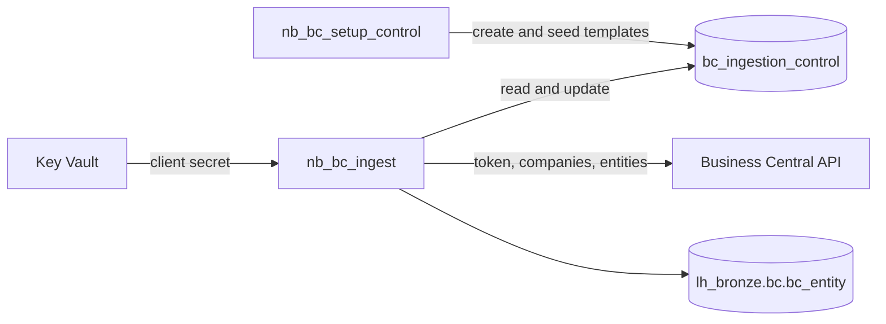

# Business Central - Notebook Summary

> **Status: dev / sandbox. The notebooks default to the `Sandbox-EGA-ITE` environment. Confirm a full run and a pipeline before using in production.**

All the Fabric notebooks that load Business Central (BC) into `lh_bronze`, what each one does, and how it is run.

Back to [Datasource to Bronze Notebooks](/BI-Team/Documentation-%2D-Data-Dudes/Fabric-Conversion/Datasource-to-Bronze-Notebooks).

## Sub pages

- [Business Central - nb_bc_setup_control](/BI-Team/Documentation-%2D-Data-Dudes/Fabric-Conversion/Datasource-to-Bronze-Notebooks/Business-Central-%2D-Notebook-Summary/Business-Central-%2D-nb_bc_setup_control): one-off setup of the control table and entity templates
- [Business Central - nb_bc_ingest](/BI-Team/Documentation-%2D-Data-Dudes/Fabric-Conversion/Datasource-to-Bronze-Notebooks/Business-Central-%2D-Notebook-Summary/Business-Central-%2D-nb_bc_ingest): metadata-driven load of every enabled entity for every company into bronze

## At a glance

| Item | Type | Function | Run how |
|---|---|---|---|
| [`nb_bc_setup_control`](/BI-Team/Documentation-%2D-Data-Dudes/Fabric-Conversion/Datasource-to-Bronze-Notebooks/Business-Central-%2D-Notebook-Summary/Business-Central-%2D-nb_bc_setup_control) | Notebook (setup) | Creates `bc_ingestion_control` and seeds 23 entity templates | Once, and again only to add or change templates. Safe to re-run. |
| [`nb_bc_ingest`](/BI-Team/Documentation-%2D-Data-Dudes/Fabric-Conversion/Datasource-to-Bronze-Notebooks/Business-Central-%2D-Notebook-Summary/Business-Central-%2D-nb_bc_ingest) | Notebook (load) | Discovers companies, reads the control table, calls the BC API and loads `lh_bronze.bc.bc_<entity>` | Manually for now. A pipeline is still to be built. |



## Notebooks

### `nb_bc_setup_control`
- **Function:** creates the control table and seeds one **template row** per entity (`company_id = '*'`).
- **Key behaviour:** the table is only created if missing and seeds are `MERGE`d, so existing templates are never overwritten.
- **Run:** set `table_namespace`, `control_table` and `custom_api_path`, then run all cells.
- **Detail:** [Business Central - nb_bc_setup_control](/BI-Team/Documentation-%2D-Data-Dudes/Fabric-Conversion/Datasource-to-Bronze-Notebooks/Business-Central-%2D-Notebook-Summary/Business-Central-%2D-nb_bc_setup_control).

### `nb_bc_ingest`
- **Function:**
  1. Gets one OAuth token (client credentials) for the run.
  2. Discovers all companies from `/api/v2.0/companies`.
  3. Adds any new company x entity combination to the control table from the templates.
  4. For each entity (up to `max_parallel_entities` at once) and each company, reads the watermark, calls the API with an OData filter, follows `@odata.nextLink`, writes bronze and updates the watermark.
- **Target:** `lh_bronze.bc.bc_<entity_in_snake_case>`, all companies together.
- **Needs:** default lakehouse `lh_bronze` and read access to the Key Vault secret `Business-Central-API`.
- **Useful parameters:** `entity_filter`, `company_filter`, `force_full_load`, `new_companies_enabled`, `max_parallel_entities`.
- **Detail:** [Business Central - nb_bc_ingest](/BI-Team/Documentation-%2D-Data-Dudes/Fabric-Conversion/Datasource-to-Bronze-Notebooks/Business-Central-%2D-Notebook-Summary/Business-Central-%2D-nb_bc_ingest).

## Run order and results

1. Run `nb_bc_setup_control` once.
2. Run `nb_bc_ingest`. On the first run new companies are added **disabled** (`new_companies_enabled = False`). Enable them with the `MERGE` printed in the log, then run again.
3. A failure on one entity is logged to the control table and the other entities still run. At the end the notebook raises an error if any load failed (`fail_on_error`).
4. The next run continues from each watermark, so re-running is safe.

The notebook ends with `notebookutils.notebook.exit(...)` returning JSON: `run_id`, `loads`, `failed`, `rows`.

## Checking a run

```sql
SELECT company_name, entity, load_mode, last_run_status, last_run_row_count,
       last_success_watermark, last_run_time, last_run_error_message
FROM lh_bronze.control.bc_ingestion_control
WHERE company_id <> '*'
ORDER BY last_run_time DESC;

-- failures from the last run
SELECT company_name, entity, last_run_error_message
FROM lh_bronze.control.bc_ingestion_control
WHERE last_run_status = 'Failed';
```

## Still to do

- Align the table location. `nb_bc_setup_control` defaults to `lh_bronze.dbo.bc_ingestion_control`, but `nb_bc_ingest` reads `lh_bronze.control.bc_ingestion_control`. Set both to the same table.
- Build the Silver step (de-duplicate on `company_id` + `systemId`).
- Create the pipeline with a notebook activity and a schedule matching the ADF trigger.
- Point the notebook at the production environment and Key Vault.
