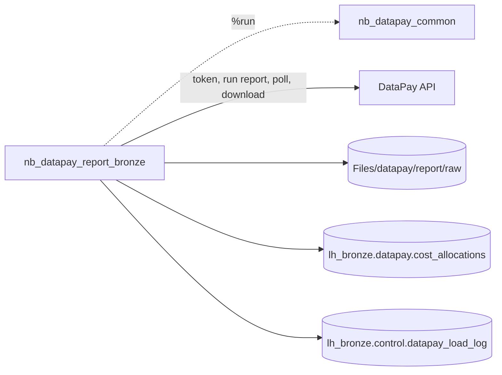

# DataPay - Notebook Summary

> **Status: draft. The notebooks have not been run in Fabric yet, and the pipeline has not been created.**

All the Fabric notebooks that load DataPay into `lh_bronze.datapay`, what each one does, and how it will be run.

Back to [Datasource to Bronze Notebooks](/BI-Team/Documentation-%2D-Data-Dudes/Fabric-Conversion/Datasource-to-Bronze-Notebooks).

## Sub pages

- [DataPay - nb_datapay_common](/BI-Team/Documentation-%2D-Data-Dudes/Fabric-Conversion/Datasource-to-Bronze-Notebooks/DataPay-%2D-Notebook-Summary/DataPay-%2D-nb_datapay_common): shared helpers (row hash, dedupe `MERGE`, load log)
- [DataPay - nb_datapay_report_bronze](/BI-Team/Documentation-%2D-Data-Dudes/Fabric-Conversion/Datasource-to-Bronze-Notebooks/DataPay-%2D-Notebook-Summary/DataPay-%2D-nb_datapay_report_bronze): runs the report, downloads the CSV and loads bronze


## At a glance

| Item | Type | Function | Run how |
|---|---|---|---|
| [`nb_datapay_common`](/BI-Team/Documentation-%2D-Data-Dudes/Fabric-Conversion/Datasource-to-Bronze-Notebooks/DataPay-%2D-Notebook-Summary/DataPay-%2D-nb_datapay_common) | Notebook (helpers) | Shared functions: column cleaning, row hash, dedupe `MERGE` into bronze, load log | Never run on its own. Pulled in with `%run nb_datapay_common` by the report notebook. |
| [`nb_datapay_report_bronze`](/BI-Team/Documentation-%2D-Data-Dudes/Fabric-Conversion/Datasource-to-Bronze-Notebooks/DataPay-%2D-Notebook-Summary/DataPay-%2D-nb_datapay_report_bronze) | Notebook (load) | Runs the DataPay *Cost Allocation* report for a date window, downloads the CSV and loads it into `lh_bronze.datapay.cost_allocations` | Manually from the notebook for now. A pipeline is still to be built. |



## Notebooks

### `nb_datapay_common`
- **Function:** the shared bronze-load toolkit (`to_snake`, `clean_columns`, `add_row_hash`, `upsert_bronze`, `write_load_log`, `run_id`).
- **Key behaviour:** every column is stored as text. A new row is inserted, and an identical row only moves its `_last_seen_*` columns forward. The report window (`_report_start_date`, `_report_end_date`) is kept outside the row hash so overlapping windows do not create duplicates.
- **Run:** not run directly. It must exist in the same workspace under this exact name.
- **Detail:** [DataPay - nb_datapay_common](/BI-Team/Documentation-%2D-Data-Dudes/Fabric-Conversion/Datasource-to-Bronze-Notebooks/DataPay-%2D-Notebook-Summary/DataPay-%2D-nb_datapay_common).

### `nb_datapay_report_bronze`
- **Function:**
  1. Gets an access token from DataPay (the form body comes from Key Vault secret `DataPay-Authorization-Token`).
  2. Starts the subscribed report as CSV for the window (default today minus 14 days to today, NZ time).
  3. Polls every 30 seconds, up to 15 minutes, until the status is `Completed` or `Completed with No Data`.
  4. Downloads the CSV and keeps a copy in `Files/datapay/report/raw/yyyy/MM/dd/`.
  5. Loads it with the dedupe-on-row-hash pattern and writes one row to the load log.
- **Target:** `lh_bronze.datapay.cost_allocations`.
- **Needs:** default lakehouse `lh_bronze` (schema-enabled) and read access to the Key Vault secret.
- **Useful parameters:** `lookback_days` (default 14), `start_date` / `end_date` (back-load a period), `poll_interval_s`, `poll_timeout_min`, `load_mode`.
- **Run:** open the notebook with `lh_bronze` attached and run all cells. For a back-load set `start_date` and `end_date`.
- **Detail:** [DataPay - nb_datapay_report_bronze](/BI-Team/Documentation-%2D-Data-Dudes/Fabric-Conversion/Datasource-to-Bronze-Notebooks/DataPay-%2D-Notebook-Summary/DataPay-%2D-nb_datapay_report_bronze).

## Run order and results

1. `%run nb_datapay_common` loads the helpers.
2. The notebook runs the report and waits. A `Completed with No Data` result is logged as succeeded with 0 rows and nothing is downloaded.
3. Any failure (token, report status, timeout, load) is logged with the error text, then the notebook raises an error so a pipeline activity would show as failed.
4. The next run retries by running the window again. Because the load is deduped on the row hash, repeating a window is safe.

The notebook ends with `notebookutils.notebook.exit(...)` returning JSON: `run_id`, `batch_no`, `report`, `status`, `window`, `rows_read`, `rows_inserted`.

## Checking a run

```sql
SELECT TOP 50 *
FROM lh_bronze.control.datapay_load_log
ORDER BY load_ts DESC;

-- rows by report window
SELECT _report_start_date, _report_end_date, COUNT(*) AS row_count
FROM lh_bronze.datapay.cost_allocations
GROUP BY _report_start_date, _report_end_date
ORDER BY _report_end_date DESC;
```

## Still to do

- Test the notebooks in Fabric with a known past window and compare the row count to the ADF output.
- Confirm that DataPay accepts calls from Fabric (ADF used `IntegrationRuntimeAUS`).
- Create `pl_datapay_to_bronze` with a notebook activity for `nb_datapay_report_bronze` and a schedule matching the ADF trigger.
- Move the downstream consumer (*Process Cost Allocations*) to read the bronze table.

The full list of open points is on [DataPay - Cost Allocation to Bronze](/BI-Team/Documentation-%2D-Data-Dudes/Fabric-Conversion/Datasource-to-Bronze-Notebooks/DataPay-%2D-Notebook-Summary/DataPay-%2D-Cost-Allocation-to-Bronze).
