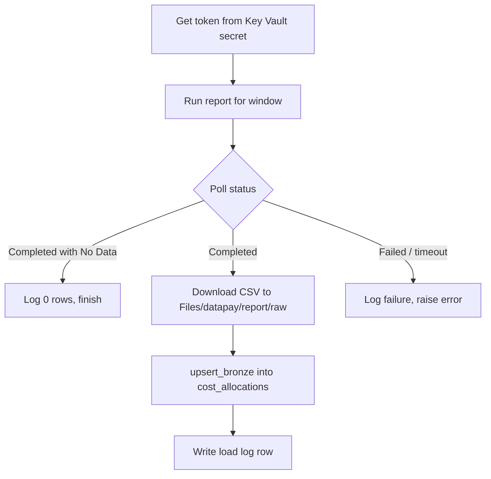

# DataPay - nb_datapay_report_bronze

> **Status: draft. The notebook has not been run in Fabric yet.**

Loads the DataPay *Cost Allocation* report into `lh_bronze.datapay.cost_allocations`. It replaces the ADF pipeline *Datapay Report Cost Allocation*.

Back to [DataPay - Notebook Summary](/BI-Team/Documentation-%2D-Data-Dudes/Fabric-Conversion/Datasource-to-Bronze-Notebooks/DataPay-%2D-Notebook-Summary). Helpers: [nb_datapay_common](/BI-Team/Documentation-%2D-Data-Dudes/Fabric-Conversion/Datasource-to-Bronze-Notebooks/DataPay-%2D-Notebook-Summary/DataPay-%2D-nb_datapay_common). ADF comparison and open points: [DataPay - Cost Allocation to Bronze](/BI-Team/Documentation-%2D-Data-Dudes/Fabric-Conversion/Datasource-to-Bronze-Notebooks/DataPay-%2D-Notebook-Summary/DataPay-%2D-Cost-Allocation-to-Bronze).

## What it does

1. Gets an access token from DataPay. The form body for the token request comes from Key Vault secret `DataPay-Authorization-Token`.
2. Starts the subscribed report as CSV for a date window (default today minus 14 days to today, NZ time).
3. Polls every 30 seconds, up to 15 minutes, until the status is `Completed` or `Completed with No Data`.
4. Downloads the CSV and keeps a copy in `Files/datapay/report/raw/yyyy/MM/dd/`.
5. Loads it with the dedupe-on-row-hash pattern into `lh_bronze.datapay.cost_allocations` and writes one row to `lh_bronze.control.datapay_load_log`.



## Requirements

- Default lakehouse: `lh_bronze` (schema-enabled).
- `nb_datapay_common` in the same workspace.
- The identity running the notebook can read Key Vault secret `DataPay-Authorization-Token`.
- DataPay accepts calls from Fabric (ADF used `IntegrationRuntimeAUS`; to be confirmed).

## Parameters (first code cell)

| Parameter | Default | Purpose |
|---|---|---|
| `key_vault_url` | `https://kv-dev-nzn-data-platform.vault.azure.net/` | Key Vault holding the token request body |
| `token_secret_name` | `DataPay-Authorization-Token` | Secret containing the form-urlencoded token request body |
| `auth_url` | `https://auth.datapaylive.co.nz/connect/token` | DataPay token endpoint |
| `api_base_url` | `https://www.datapaylive.co.nz/enterprise/api` | DataPay API base |
| `report_id` | `d6XZY6LCYOEhTzWuff3HkA` | Subscribed report id |
| `report_name` | `cost_allocations` | Bronze table name (made snake_case) and log object name |
| `lookback_days` | `14` | Window start = end minus this many days |
| `start_date`, `end_date` | blank | `yyyy-MM-dd` overrides for back-loading. Blank end = today, blank start = end minus `lookback_days`. |
| `poll_interval_s` | `30` | Seconds between status checks |
| `poll_timeout_min` | `15` | Longest wait for the report |
| `request_timeout_s` | `100` | Timeout on each HTTP call |
| `target_schema` | `lh_bronze.datapay` | Bronze schema |
| `load_mode` | `dedupe` | `dedupe` or `append` |
| `raw_folder` | `Files/datapay/report/raw` | Where downloaded CSV files are kept |
| `lakehouse_mount` | `/lakehouse/default` | Local mount of the default lakehouse |

## Sections

### 1. Header (markdown)
What the notebook replaces and the five steps above.

### 2. Parameters (code, tagged `parameters`)
The table above. A pipeline notebook activity can override any of these.

### 3. `%run nb_datapay_common` (code)
Loads the helpers. It must be alone in its cell.

### 4. Session and report functions (code)

| Item | What it does |
|---|---|
| `DataPaySession` | Wraps an HTTP session with the DataPay token. |
| `DataPaySession.login` | Reads the token request body from Key Vault and POSTs it to `auth_url` as `application/x-www-form-urlencoded`. Keeps `access_token` and works out the expiry from `expires_in` (less 60 seconds). The secret and the token are never printed. |
| `DataPaySession.request` | Sends a request with the bearer token. Re-logs in when the token is expired, or once after a `401`. Retries `429` and `5xx` responses (up to 3 times, honouring `Retry-After`). Raises on any other error. |
| `run_report(sess, start, end)` | POSTs `{StartDate, EndDate, DateOption: "period"}` to `.../v/1/subscribedreports/{report_id}/run?outputformat=csv`. |
| `report_status(sess)` | GETs the subscribed reports list and returns the `Status` of the entry whose id field (`id`, `reportid`, `subscribedreportid` or `key`) equals `report_id`. If none match it prints a warning and uses the first entry, as the ADF pipeline did. |
| `wait_for_report(sess)` | Waits `poll_interval_s` and then checks the status, repeating until `poll_timeout_min`. Returns `True` for `Completed`, `False` for `Completed with No Data`. Raises on a status containing `fail` or `error`, and raises `TimeoutError` at the limit. |
| `download_report(sess, local_path)` | Streams `.../subscribedreports/{report_id}/download` to a file in 1 MB chunks. |

The notebook waits **before** the first status check. This lets the new run replace the status of a previous run, as ADF's 30-second wait did.

### 5. Main load (code)
1. Works out `run_id`, the batch number (`yyyyMMddHHmm`, NZ time) and the report window.
2. Builds the raw file path `raw_folder/yyyy/MM/dd/<table>_<startyyyymmdd>_<endyyyymmdd>_<run_id>.csv`. Every download is kept (ADF kept only the latest file).
3. Runs the report and waits.
4. **No data:** logs 0 rows read, inserted and updated, with status `succeeded`.
5. **Data:** downloads the CSV, reads it with Spark (header row, no schema inference, `"` quote and escape, multi-line, UTF-8, `PERMISSIVE`), then calls `upsert_bronze(...)` with the report window.
6. **Header-only file:** if the CSV has no columns it is logged as succeeded with 0 rows.
7. **Any exception:** logged as `failed` with the full traceback. The notebook keeps going to step 8.
8. Writes one row to `lh_bronze.control.datapay_load_log`.

### 6. Result and exit (code)
Builds a small summary, prints it, raises `RuntimeError` if the run failed (so a pipeline activity shows as failed), and otherwise returns it with `notebookutils.notebook.exit(...)`:

```json
{ "run_id": "20261006T093000", "batch_no": 202610060930, "report": "cost_allocations",
  "status": "succeeded", "window": ["2026-09-22", "2026-10-06"], "rows_read": 1234, "rows_inserted": 56 }
```

## Window and duplicates

Each run asks for the last 14 days, so consecutive days overlap by 13 days. Because the window dates are not part of the row hash:

- rows already loaded are matched on `_row_hash` and only have `_last_seen_*` and `_report_end_date` moved forward (`rows_updated`);
- genuinely new or changed rows are inserted (`rows_inserted`).

## Running it

- **Manually:** open the notebook with `lh_bronze` attached and run all cells.
- **Back-load a period:** set `start_date` and `end_date`, then run. Re-running the same period is safe.
- **From a pipeline:** not built yet. Add a notebook activity pointing at this notebook with a schedule matching the ADF trigger.

## Checking a run

```sql
SELECT TOP 20 *
FROM lh_bronze.control.datapay_load_log
WHERE source_object = 'cost_allocations'
ORDER BY load_ts DESC;
```

## Troubleshooting

| Symptom | Likely cause |
|---|---|
| `NameError` for `run_id`, `to_snake` or `upsert_bronze` | `%run nb_datapay_common` was not run or failed. See [nb_datapay_common](/BI-Team/Documentation-%2D-Data-Dudes/Fabric-Conversion/Datasource-to-Bronze-Notebooks/DataPay-%2D-Notebook-Summary/DataPay-%2D-nb_datapay_common). |
| `401` or `403` on the token call | Secret holds the wrong body, or DataPay blocks the Fabric source IP. |
| `report id not found in status list` | The status list uses a different id field. Check the response and update `ID_KEYS`. |
| `TimeoutError` | Report took longer than `poll_timeout_min`. Raise it and re-run. |
| Table exists but has fewer columns than the CSV | Expected. `autoMerge` adds new columns on the next `MERGE`. |
