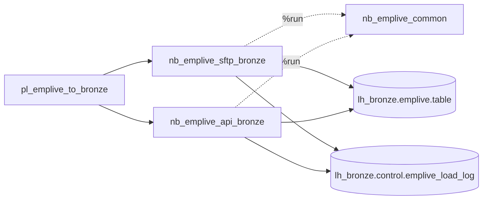

# EmpLive - Notebook Summary

All the Fabric notebooks and the pipeline that load EmpLive into `lh_bronze.emplive`, what each one does, and how it is run.

Back to [Datasource to Bronze Notebooks](/BI-Team/Documentation-%2D-Data-Dudes/Fabric-Conversion/Datasource-to-Bronze-Notebooks).

## Sub pages

- [EmpLive - nb_emplive_common](/BI-Team/Documentation-%2D-Data-Dudes/Fabric-Conversion/Datasource-to-Bronze-Notebooks/EmpLive-%2D-Notebook-Summary/EmpLive-%2D-nb_emplive_common)
- [EmpLive - nb_emplive_sftp_bronze](/BI-Team/Documentation-%2D-Data-Dudes/Fabric-Conversion/Datasource-to-Bronze-Notebooks/EmpLive-%2D-Notebook-Summary/EmpLive-%2D-nb_emplive_sftp_bronze)
- [EmpLive - nb_emplive_api_bronze](/BI-Team/Documentation-%2D-Data-Dudes/Fabric-Conversion/Datasource-to-Bronze-Notebooks/EmpLive-%2D-Notebook-Summary/EmpLive-%2D-nb_emplive_api_bronze)

## At a glance

| Item | Type | Function | Run how |
|---|---|---|---|
| `nb_emplive_common` | Notebook (helpers) | Shared functions: column cleaning, row hash, dedupe `MERGE` into bronze, load log | Never run on its own. Pulled in with `%run nb_emplive_common` by the two load notebooks. |
| `nb_emplive_sftp_bronze` | Notebook (load) | Loads the daily `Batch########.zip` files from the EmpLive SFTP server into `lh_bronze.emplive.<table>` | By the pipeline (activity *SFTP zip to bronze*), or manually from the notebook |
| `nb_emplive_api_bronze` | Notebook (load) | Loads the EmpLive REST API leave endpoints into `lh_bronze.emplive.<endpoint>` | By the pipeline (activity *API to bronze*), or manually from the notebook |
| `pl_emplive_to_bronze` | Fabric pipeline | Runs the SFTP and API notebooks in parallel | Scheduled or started manually |



## Notebooks

### `nb_emplive_common`
- **Function:** the shared bronze-load toolkit (`to_snake`, `clean_columns`, `add_row_hash`, `upsert_bronze`, `write_load_log`, `loaded_objects`, `run_id`).
- **Key behaviour:** every column is stored as text. A new row is inserted, and an identical row only moves its `_last_seen_*` columns forward.
- **Run:** not run directly. It must exist in the same workspace under this exact name.
- **Detail:** [EmpLive - nb_emplive_common](/BI-Team/Documentation-%2D-Data-Dudes/Fabric-Conversion/Datasource-to-Bronze-Notebooks/EmpLive-%2D-Notebook-Summary/EmpLive-%2D-nb_emplive_common).

### `nb_emplive_sftp_bronze`
- **Function:** lists the `Batch########.zip` files on the SFTP server, skips zips already loaded, then for each new zip (oldest first) keeps a raw copy, unzips it, and loads each `Batch########_<Table>.csv` into its own bronze table.
- **Source:** EmpLive SFTP server (password in Key Vault secret `EmpLive-sFTP`).
- **Target:** `lh_bronze.emplive.<table>` plus raw zips in `Files/emplive/sftp/raw/yyyy/MM/dd/`.
- **Needs:** default lakehouse `lh_bronze` and the `paramiko` library in the workspace Environment.
- **Useful parameters:** `lookback_days` (default 14), `batch_filter` (a single batch), `force_reload`.
- **Run:** from the pipeline, or open the notebook with `lh_bronze` attached and run all cells. Set `batch_filter` to reload one batch.
- **Detail:** [EmpLive - nb_emplive_sftp_bronze](/BI-Team/Documentation-%2D-Data-Dudes/Fabric-Conversion/Datasource-to-Bronze-Notebooks/EmpLive-%2D-Notebook-Summary/EmpLive-%2D-nb_emplive_sftp_bronze).

### `nb_emplive_api_bronze`
- **Function:** logs in to the EmpLive API, pages through each endpoint until a page is empty, and loads the records (nested values kept as JSON text).
- **Source:** EmpLive REST API (credentials in Key Vault secrets `Emplive-Api-User` and `Emplive-Api-Key`).
- **Endpoints:** `leave_requests`, `leave_codes`, `leave_types`, `leave_requestchanges`.
- **Target:** `lh_bronze.emplive.<endpoint name>`.
- **Useful parameters:** `endpoint_filter` (a single endpoint), `max_pages`, `token_max_age_min`.
- **Run:** from the pipeline, or open the notebook with `lh_bronze` attached and run all cells. Set `endpoint_filter` to run one endpoint.
- **Detail:** [EmpLive - nb_emplive_api_bronze](/BI-Team/Documentation-%2D-Data-Dudes/Fabric-Conversion/Datasource-to-Bronze-Notebooks/EmpLive-%2D-Notebook-Summary/EmpLive-%2D-nb_emplive_api_bronze).

## Pipeline: `pl_emplive_to_bronze`

- **Function:** starts both load notebooks at the same time. The two activities have no dependency on each other, so a failure in one does not stop the other.
- **Activities:** *SFTP zip to bronze* and *API to bronze* (Fabric notebook activities).
- **Settings on each activity:** timeout 2 hours, 1 retry after 10 minutes.
- **Pipeline parameters:** `key_vault_url`, `sftp_lookback_days` (14), `sftp_batch_filter`, `sftp_force_reload` (false), `api_endpoint_filter`. Confirm in Fabric that these are mapped to the notebook parameters, because the exported activities carry the same values as fixed settings.
- **Schedule:** none is included in the pipeline package. Add a trigger in Fabric for the required frequency.
- **Run:** start it from the Fabric pipeline page with *Run*, or from a schedule trigger.

## Running order and results

1. The pipeline starts both notebooks. Each one runs `%run nb_emplive_common` first.
2. Each notebook loads its data and writes one row per file or endpoint to `lh_bronze.control.emplive_load_log`.
3. If any file or endpoint fails, the notebook raises an error at the end, so the pipeline activity shows as failed. Successful items are already loaded.
4. The next run retries: failed zips are picked up again automatically, and the API re-reads the endpoints. Because the load is deduped on the row hash, repeating a load is safe.

Each notebook ends with `notebookutils.notebook.exit(...)` returning a JSON summary:
- SFTP: `run_id`, `zips_loaded`, `zips_failed`, `failed`.
- API: `run_id`, `batch_no`, `endpoints_loaded`, `failed`.

## Checking a run

```sql
-- latest runs (Lakehouse SQL endpoint)
SELECT TOP 50 *
FROM lh_bronze.control.emplive_load_log
ORDER BY load_ts DESC;

-- failures only
SELECT source, source_object, source_file, target_table, error, load_ts
FROM lh_bronze.control.emplive_load_log
WHERE status = 'failed'
ORDER BY load_ts DESC;
```

## Prerequisites

- Notebooks and the pipeline are in the same Fabric workspace, with `lh_bronze` (schema-enabled) as the default lakehouse.
- The `lh_bronze.control` and `lh_bronze.emplive` schemas are created by the notebooks if they are missing.
- The identity that runs the notebooks can read the Key Vault secrets listed above.
- `paramiko` is installed in the workspace Environment (SFTP notebook only).
